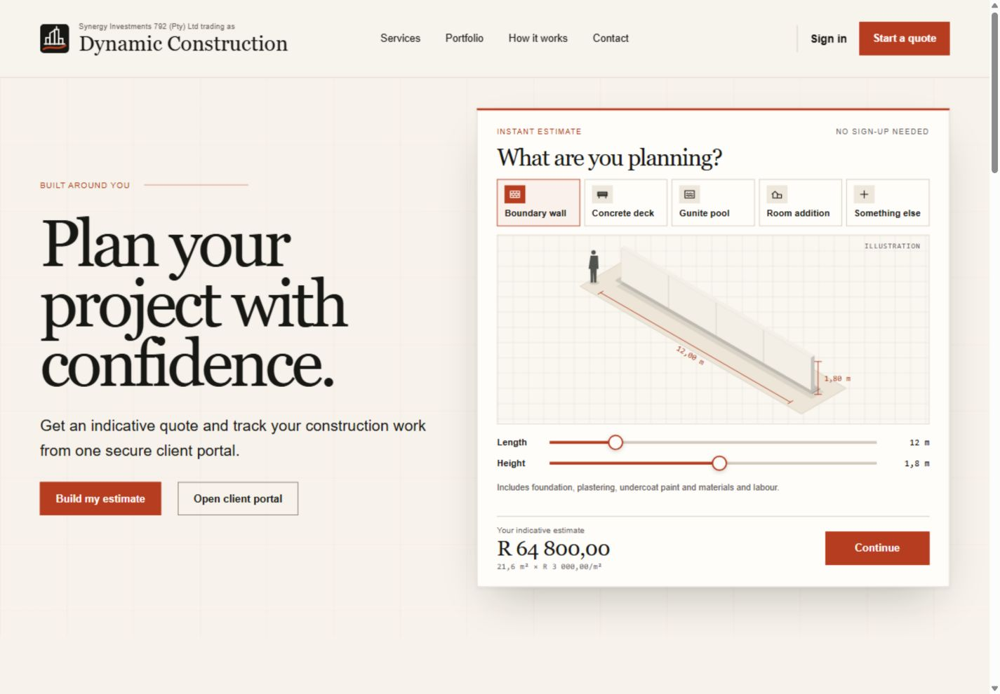
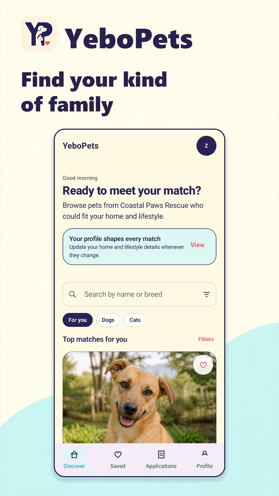
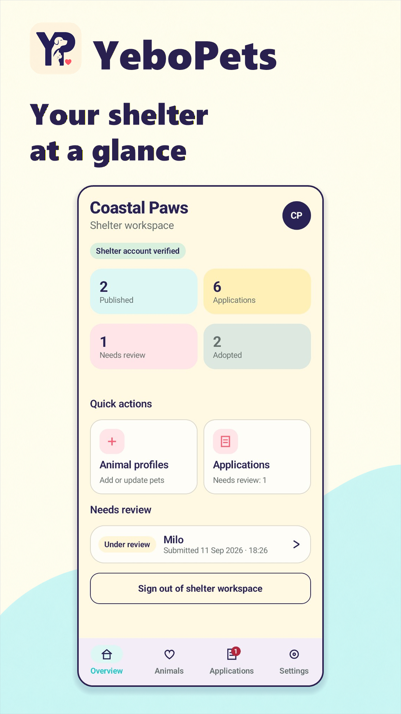
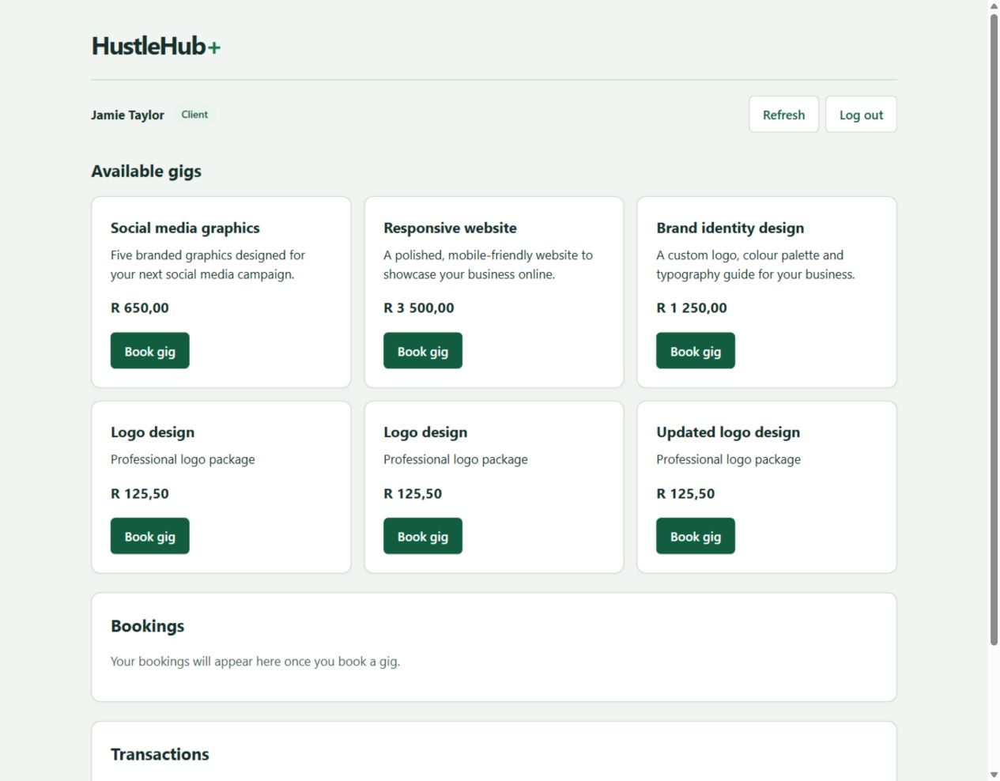
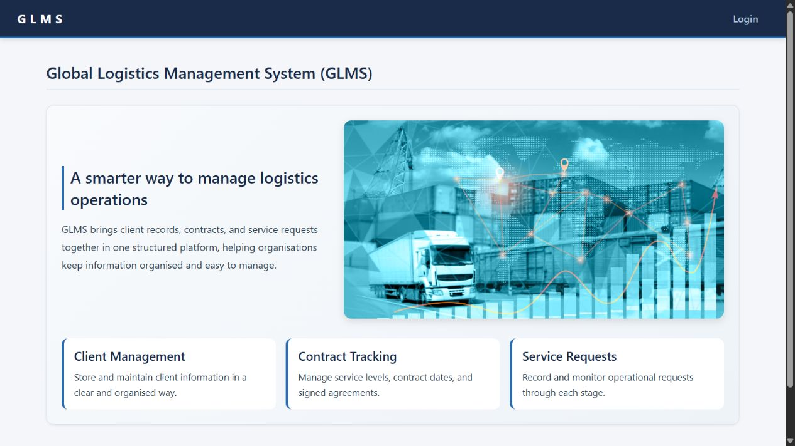
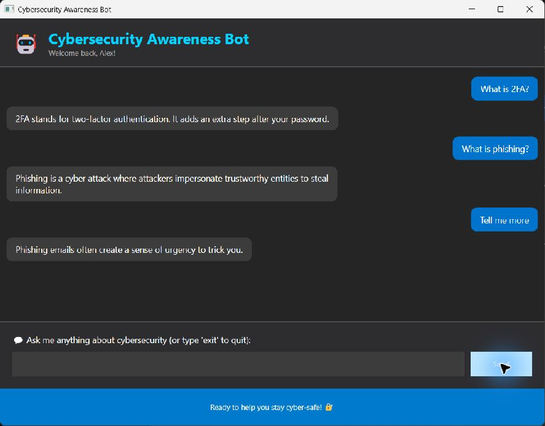

  

  

  <a href="#selected-work">Selected work</a> &nbsp; / &nbsp;
  <a href="#toolkit">Toolkit</a> &nbsp; / &nbsp;
  <a href="#contributions">Contributions</a> &nbsp; / &nbsp;
  <a href="https://github.com/rkawulesar?tab=repositories">All repositories ↗</a>

I'm a **Junior Software Developer** and final-year student completing a **Bachelor of Computer and Information Sciences in Application Development**.

I build full-stack web applications, REST APIs and Android apps using **C#, ASP.NET Core, React, Kotlin and Java**. My work spans authentication and access control, database design, automated testing, CI/CD and deployment on Microsoft Azure.

## Selected work

Five projects across web, mobile, desktop and backend development. Each repository includes its own setup instructions and technical details.

<table>
<tr>
<td width="45%" align="center">
  
</td>
<td width="55%">
  01 / FULL-STACK WEB
  <h3><a href="https://github.com/rkawulesar/dynamic-construction">Dynamic Construction</a></h3>
  
A construction platform connecting the public website, client portal and staff workspace, from quotations to project tracking and finance.

  
React · TypeScript · ASP.NET Core · SQL Server · Azure

  
<a href="https://github.com/rkawulesar/dynamic-construction">View repository ↗</a> &nbsp; · &nbsp; <a href="https://youtu.be/r0GW_skkptA">Watch demo</a>

</td>
</tr>
<tr>
<td align="center">
  
  &nbsp;
  
</td>
<td>
  02 / ANDROID + API
  <h3><a href="https://github.com/rkawulesar/YeboPets">YeboPets</a></h3>
  
A pet adoption app with discovery, compatibility matching and an adoption journey, with dedicated adopter and shelter workspaces.

  
Kotlin · Jetpack Compose · ASP.NET Core · MongoDB

  
<a href="https://github.com/rkawulesar/YeboPets">View repository ↗</a> &nbsp; · &nbsp; <a href="https://youtu.be/BD9olrDYSpg">Watch demo</a>

</td>
</tr>
<tr>
<td align="center">
  
</td>
<td>
  03 / MARKETPLACE
  <h3><a href="https://github.com/rkawulesar/hustlehub-plus">HustleHub+</a></h3>
  
A freelance marketplace for service listings and bookings, with transaction history and an income dashboard for freelancers.

  
React · Express · MongoDB · Docker

  
<a href="https://github.com/rkawulesar/hustlehub-plus">View repository ↗</a> &nbsp; · &nbsp; <a href="https://youtu.be/v8cnh0CgoJU">Watch demo</a>

</td>
</tr>
<tr>
<td align="center">
  
</td>
<td>
  04 / BUSINESS APPLICATION
  <h3><a href="https://github.com/rkawulesar/global-logistics-management-system">Global Logistics Management System</a></h3>
  
A logistics application for managing clients, contracts and service requests, with separate MVC and REST API applications.

  
C# · ASP.NET Core MVC / Web API · EF Core · SQL Server

  
<a href="https://github.com/rkawulesar/global-logistics-management-system">View repository ↗</a>

</td>
</tr>
<tr>
<td align="center">
  
</td>
<td>
  05 / WINDOWS DESKTOP
  <h3><a href="https://github.com/rkawulesar/cybersecurity-awareness-chatbot">Cybersecurity Awareness Chatbot</a></h3>
  
A Windows desktop app for learning everyday cybersecurity through topic-based chat, security tasks and reminders, and a 15-question quiz with answer explanations.

  
C# · WPF · XAML · .NET 9

  
<a href="https://github.com/rkawulesar/cybersecurity-awareness-chatbot">View repository ↗</a>

</td>
</tr>
</table>

<strong>My contributions &amp; technical highlights</strong>

- **Dynamic Construction:** Database and migrations, client and finance workflows, CI/CD, and improvements to MFA and account validation.
- **YeboPets:** API persistence, saved-state synchronisation, private media, push processing, API tests and the original app icon.
- **HustleHub+:** Finance API, illustrative tax calculation, financial event logging and HTTPS integration.
- **GLMS:** JWT authentication, currency conversion and automated tests, with Repository, Factory, Strategy and Observer patterns.

- **Cybersecurity Awareness Chatbot:** Keyword-based topic responses, follow-up tips, in-memory task management, quiz feedback and a session activity log.

These academic projects include individual and group work. The group repositories credit the full teams and their contributions.

## Toolkit

| Focus | Technologies |
| :--- | :--- |
| **Web & APIs** | C# · ASP.NET Core · React · TypeScript · Node.js · Express |
| **Mobile** | Kotlin · Jetpack Compose · Java |
| **Desktop** | WPF · XAML · .NET |
| **Data** | SQL Server · Entity Framework Core · MongoDB · Room |
| **Quality & delivery** | xUnit · NUnit · Vitest · Android JVM tests · GitHub Actions · Docker · Azure |
| **Application security** | JWT authentication · Role-based access control · MFA |

## Contributions

  <picture>
    <source media="(prefers-color-scheme: dark)" srcset="https://raw.githubusercontent.com/rkawulesar/rkawulesar/output/github-snake-dark.svg" />
    <source media="(prefers-color-scheme: light)" srcset="https://raw.githubusercontent.com/rkawulesar/rkawulesar/output/github-snake.svg" />
    
  </picture>

---

Rivaan Kawulesar &nbsp; / &nbsp; Software, from interface to infrastructure.

  

